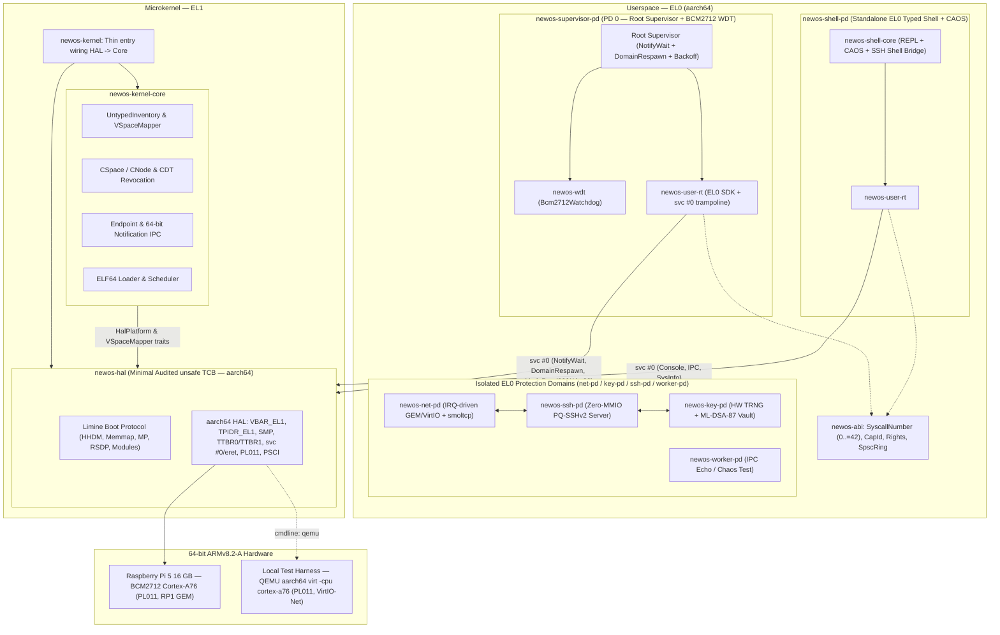
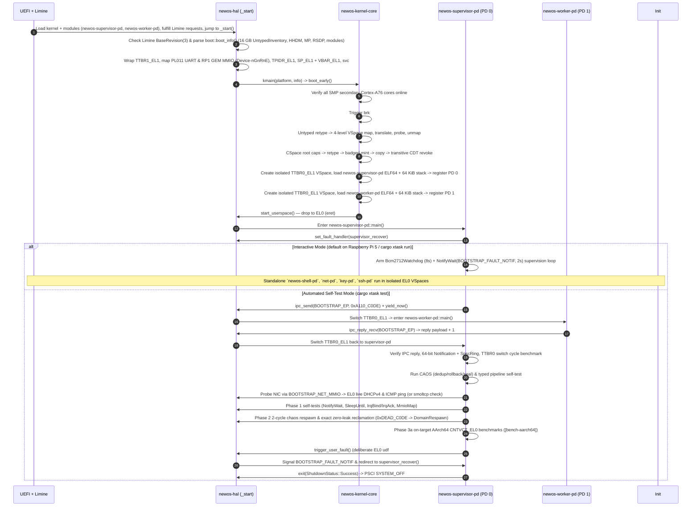

# NewOS

> **Release:** [`v0.9.0`](https://github.com/laurentgrangeau/newos/releases/tag/v0.9.0) · `main` is on `0.10.0` development.

A **64-bit capability microkernel** and **EL0 userspace environment** for the **Raspberry Pi 5 16 GB** (`aarch64` / ARMv8.2-A quad-core BCM2712 Cortex-A76, with QEMU `aarch64` `virt` as a local test harness). Features **static EL1 memory management**, **workspace-enforced `unsafe_code = "forbid"`** (with audited `unsafe` confined to `crates/hal` and `crates/user-rt`), **Kernel PIE + Limine KASLR**, **Userspace PIE + full ASLR + KCFI + LLVM ShadowCallStack (`x18`)**, **quad-core SMP EL0 scheduling with GICv2 SGI wakeups & cross-core blocking IPC**, **isolated `TTBR0_EL1` address spaces (16-bit ASIDs + full NEON/FP save/restore)**, **EL0 crash isolation**, **live ACPI hardware discovery (`FADT`/`SPCR`/`MADT`/`GTDT`/`MCFG`)**, a **Raspberry Pi 5 (16 GB) EL0 hardware driver stack** (**BCM2712 Watchdog**, **RP1 40-pin GPIO**, **VideoCore Mailbox**, **AVS TMON Thermal & Active Cooler Fan**, **RTC**, **RP1 UART/I2C/SPI/PWM**, **BCM2712 MIP MSI-X**, **PCIe ECAM**, **microSD SDHCI**, **NVMe 1.4**, **RP1 Dual xHCI USB 3.0**, **UEFI GOP Framebuffer**, **`brcm,bcm2712-iommu`**, **VideoCore VII V3D 7.1**, **Cortex-A76 NEON/DotProd AI Compute**, and **Hailo-8/8L/10H PCIe NPU**), a **3-domain privilege-separated post-quantum SSHv2 service (`newos-net-pd` + `newos-key-pd` + `newos-ssh-pd`)** with **hardware TRNG (`BCM2712 iproc-rng200` / `VirtIO-RNG`)**, an **EL0 `smoltcp` IPv4/IPv6 TCP/IP stack + RP1 Cadence GEM Gigabit Ethernet driver** (plus VirtIO 1.0+ for QEMU testing), a **FIPS 202 `SHA3-512` Content-Addressed Object Store (CAOS)**, and a **UTF-8 Typed Pipeline Shell (`newos-shell-pd`)**.

## Architecture Principles

- **Strict Liedtke Minimality & Designated-Authority Object Capabilities (EL1):**
  - Only CPU/exception dispatch, 4-level `VSpace` page tables, `CSpace` capability & `Untyped` memory enforcement, preemptive thread scheduling, and minimal IPC (`Endpoint`, 64-bit `Notification`, capability-scoped `MmioRegion`) live in the kernel.
  - **Zero Ambient Authority:** All privileged syscalls require explicit, unforgeable `CapId` handles validated in the caller's isolated per-domain `CNode<64>` — including `Console` (`DebugRead`/`DebugWrite`), `PowerControl` (`Exit`/`SysInfo`/`DomainRespawn`/`DomainGetFaultInfo`/`MemStats`), `VSpace` (`MapPage`/`UnmapPage`/`VirtToPhys`/`FrameMap`/`MmioMap`), `Untyped` (`UntypedRetype`), `CNode` (`CapGrant`), `Notification` (`NotifySignal`/`NotifyPoll`/`NotifyWait`), `IrqHandler` (`IrqBind`/`IrqAck`), and `Thread` (`SetPriority`/`DomainDestroy`). Non-supervisor `worker-pd` protection domains receive least-privilege bootstrap caps (`BOOTSTRAP_NOTIF`, `BOOTSTRAP_EP`, write-only `BOOTSTRAP_CONSOLE`, `BOOTSTRAP_SELF_THREAD`) and cannot shut down the machine, steal UART input, map memory, or escalate priority.
  - **Cross-Process CDT Revocation & Revocation-Driven Unmap:** `CapGrant` preserves cross-`CNode` `ExternalParent` links so `CapRevoke` transitively revokes capabilities across multi-hop domain chains and automatically unmaps/reclaims any revoked `Frame` PTEs via `FrameMappingTracker`.
  - **Single-Use Reply Capabilities & Full 64-Bit IPC Badges:** `IpcCall` mints an implicit single-use Reply capability consumed on `IpcReplyRecv` (preventing reply hijacking); `svc #0` returns `(x0 = err, x1 = payload, x2 = badge)` with zero badge truncation. Compacted `CapSlot` (48 B), `CNode<64>` (3,096 B), and `KernelIpcState` (25,224 B) pair with O(1) leaf CDT revocation, O(1) per-endpoint waiter bitmasks, and coalesced 1024 B `DebugWrite` / REPL I/O to minimize IPC overhead.
  - Zero kernel heap (`no_alloc`): all 16 GB of physical memory is tracked in `UntypedInventory` (64 regions, auto-binding `BOOTSTRAP_UNTYPED` to the largest usable UEFI region) with region-designated `retype_frame_in`, zero-on-free LIFO frame reclamation, and 2 MiB superpages.
  - Networking (`smoltcp` IPv4/IPv6/DHCPv4/DNS A+AAAA/ICMP/TCP + Raspberry Pi 5 RP1 Cadence GEM Gigabit Ethernet & QEMU single-slot VirtIO 1.0+), storage (CAOS), shell (`newos-shell-pd`), bounds-hardened shared-memory `SpscRing` buffers, and crash supervision live in isolated EL0 protection domains.
- **Memory Safety & Formal Verification:**
  - `unsafe_code = "forbid"` is enforced at the workspace level in `Cargo.toml` across all 26 non-TCB crates (`newos-abi`, `newos-crypto`, `newos-kernel-core`, `newos-kernel`, `newos-net`, `newos-rng`, `newos-wdt`, `newos-gpio`, `newos-board`, `newos-storage`, `newos-usb`, `newos-gpu`, `newos-ai`, `newos-key-vault`, `newos-ssh-proto`, `newos-net-pd`, `newos-key-pd`, `newos-ssh-pd`, `newos-ssh`, `newos-shell-core`, `newos-supervisor-pd`, `newos-shell-pd`, `newos-worker-pd`, `newos-bench`, `xtask`, and `tests`).
  - Audited `unsafe` is strictly confined to hardware/paging/context-switch instructions in `crates/hal` (guarded by IRQ-disabling `IrqSpinLock`s, bounded descriptor helpers, and page-table-validated HHDM user copies) and the minimal `svc #0` / fault-recovery trampoline in `crates/user-rt` (with `set_fault_handler` implemented via `[AtomicU64; 8192]`), with documented `// SAFETY:` invariants on every site.
  - **Miri, Kani & E2E Verification:** `cargo test` runs **448+** host tests (**153+** unit tests across 15 crates + **295** E2E tests in `tests/e2e` and `tests/teamwork_e2e`) and `cargo xtask miri` checks UB/aliasing/provenance across the core and hardware driver suites (excluding multi-minute PQ lattice crates); `#[cfg(kani)]` bounded model checking harnesses (`cargo xtask verify`) prove `SpscRing` FIFO & corrupted-peer safety, `CNode` monotonic rights attenuation & generational `CapId` safety, `notify_consume_mask` atomicity, `PageFlags` W^X exclusivity, and `UntypedInventory` disjointness.
  - **DMA Trust Boundary & Unintegrated Driver Libraries:** `newos-net-pd` holds a kernel-enforced `BOOTSTRAP_IOSPACE` (`DmaMap`/`DmaUnmap` with Normal Non-Cacheable `DMA_FLAG_NON_CACHEABLE` support) alongside NIC MMIO; because Raspberry Pi 5 RP1 Ethernet does not sit behind an ARM SMMUv3, `newos-net-pd` remains part of the DMA TCB on Pi 5. `newos-wdt` (`Bcm2712Watchdog`) is wired into PD 0's interactive Root Supervisor loop (feature-gated by `[drivers].wdt`); the remaining 6 Raspberry Pi 5 hardware driver crates (`newos-gpio`, `newos-board`, `newos-storage`, `newos-usb`, `newos-gpu`, `newos-ai`) are currently unintegrated EL0 driver libraries tested against unit mocks and not yet wired into the boot image.
  - **SSH Protocol & CAOS Hashing Notes:** The SSH server uses private post-quantum algorithm names (`mlkem1024-sha3-512`, `ssh-mldsa87`, `chacha20-poly1305@openssh.com`) with `newos-ssh` (requiring `--fingerprint` by default) and is not wire-compatible with stock OpenSSH clients. CAOS object hashes (`ObjHash`) use a 64-bit prefix of `SHA3-512`; boot module digests are logged as boot-time measurements.
- **Defense-in-Depth AArch64 Security Hardening:**
  - **KASLR, PIE & Full EL0 ASLR:** Kernel compiled as PIE (`-C relocation-model=pie`) with Limine KASLR and `PT_GNU_RELRO` read-only locking; EL0 binaries compiled as PIE (`ET_DYN`) with streaming `R_AARCH64_RELATIVE` relocation, randomized code/stack/shadow-stack bases (seeded with early BCM2712 hardware TRNG on Pi 5), unmapped 4 KiB stack guard pages, and **FIPS 202 `SHA3-512`** boot measurement digests (`elf-measurement`).
  - **3-Domain Post-Quantum SSHv2 Service (`newos-net-pd` + `newos-key-pd` + `newos-ssh-pd`):**
    - **NIST Level 5 Suite:** Enforces `mlkem1024-sha3-512` (FIPS 203 ML-KEM-1024 + SHA3-512), hedged `ssh-mldsa87` (FIPS 204 ML-DSA-87 with distinct domain contexts `newos-ssh-kex-v1` / `newos-ssh-userauth-v1`), `chacha20-poly1305@openssh.com` (constant-time ARX AEAD), `SHA3-512`/`SHAKE256`, and `kex-strict` (Terrapin CVE-2023-48795 mitigation). Rejects classical KEX, RSA/ECDSA/Ed25519, passwords, `exec`, SFTP, and forwarding.
    - **Hardware Entropy & Fast-Key-Erasure CSPRNG (`newos-rng`):** Capability-scoped `BOOTSTRAP_RNG_MMIO` supporting **Raspberry Pi 5 BCM2712 `iproc-rng200`** (`0x10_7D20_8000`, no DMA) and **QEMU `virtio-rng-device`**, with fail-closed NIST SP 800-90B startup health checks (RCT + APT) → `SHAKE256` conditioning → fast-key-erasure ChaCha20 CSPRNG.
    - **Privilege Separation:** `newos-net-pd` (PD 2) exclusively owns `BOOTSTRAP_NET_MMIO`, `BOOTSTRAP_NET_IRQ`, `BOOTSTRAP_VSPACE` (`R|W`), `BOOTSTRAP_NET_NOTIF`, and `BOOTSTRAP_NET_SSH_RING`; `newos-key-pd` (PD 3) exclusively owns `BOOTSTRAP_RNG_MMIO`, `BOOTSTRAP_KEY_NOTIF`, `BOOTSTRAP_SSH_KEY_RING`, the ephemeral ML-DSA-87 host private key, single-use `session_id` replay protection, and write-only `BOOTSTRAP_AUTH_GATE_EP` (`key-pd` → `newos-shell-pd`); `newos-ssh-pd` (PD 4) holds zero MMIO, write-only `BOOTSTRAP_VSPACE` (`FrameMap` only, never `VirtToPhys`), `BOOTSTRAP_SSH_NOTIF`, `BOOTSTRAP_NET_SSH_RING`, `BOOTSTRAP_SSH_KEY_RING`, and no `AUTH_GATE_EP`, bridged to `newos-shell-pd` over unidirectional `BOOTSTRAP_SSH_SHELL_EP` / `BOOTSTRAP_SSH_OUT_EP` pipes.
  - **Control-Flow Integrity & ShadowCallStack:** `-Z sanitizer=kcfi` across EL1/EL0, plus real LLVM `-Z sanitizer=shadow-call-stack` (`x18` via `targets/aarch64-newos-user.json`) with per-domain ASLR 8 KiB shadow stacks.
  - **Microarchitectural & Hardware Mitigations:** Probed ARMv8.2-A Cortex-A76 mitigations (`PAN`, `SSBS` / `SCTLR_EL1.DSSBS`, `CSV2`, `CSV3`); Cortex-A76 24-iteration Spectre-BHB clearing on EL0→EL1 entry; `csdb` Spectre v1 barriers; GPR/NEON scrubbing on fault redirect; zero-on-free frame reclaim; DMA cache maintenance (`dc cvac`/`dc civac`); capability-typed `IoSpace` placeholder reserved for BCM2712's `brcm,bcm2712-iommu` (BCM2712 does not include ARM SMMUv3).
- **EL0 Storage & Typed Shell:**
  - **Content-Addressed Object Store (CAOS):** Immutable blobs addressed by `const fn` **FIPS 202 `SHA3-512`** `ObjHash` with automatic deduplication, collision rejection, lock-free reads, mark-and-sweep `gc()`, validated binary snapshots (`encode_snapshot`/`decode_snapshot`), capability-gated named Refs (`@name`), instant atomic `rollback`, and irreversible `seal` (read-only attenuation).
  - **Typed Pipeline Shell (`newos-shell-pd`):** Full UTF-8 multi-byte input & scalar-aware backspace; stages pass typed `Record` values (`Proc`, `Object`, `Ref`, `Metric`, `Count`) directly through `|` (`put "hello" | save @note`, `objects | where size > 20`, `domains | where el == 0 | count`, `net dhcp`, `net ping`, `net resolve`).
- **Raspberry Pi 5 (16 GB) Hardware Target:**
  - 64-bit `aarch64` compiled for `-C target-cpu=cortex-a76` (`+v8.2a,+neon,+crc,+lse,+dotprod,+fp16,+crypto`).
  - **Core SoC, SMP & Memory:** **UEFI GPT + FAT32 ESP** disk images (`xtask/src/gpt.rs`), Limine + UEFI GOP framebuffer discovery, live **ACPI** hardware discovery (`FADT` PSCI `SMC`/`HVC` `SYSTEM_OFF` + `SYSTEM_RESET`, `SPCR` PL011 UART, `MADT` GICv2/GIC-400 + CPUs, `GTDT` Generic Timer GSIV, `MCFG` PCIe ECAM), GIC-400 SPI routing/triggering + **BCM2712 MIP MSI-X** (`0x10_0013_0000`), quad-core SMP EL0 scheduling with cross-core blocking IPC, probed ARMv8.2-A ISA extensions (`CpuFeatures`), `PMUv3` (`PMCCNTR_EL0`), 4-level `TTBR0_EL1`/`TTBR1_EL1` with 16-bit ASIDs & validated ≥40-bit `TCR_EL1.IPS` for 16 GB RAM, PAN-safe `DmaCacheOp` (`dc cvac`/`dc civac`), and **BCM2712 Hardware Watchdog** (`0x10_7D20_0000`, `newos-wdt`).
  - **Board I/O, Storage, USB, GPU & AI/NPU (EL0 Drivers):** BCM2712 3-pin JST Debug PL011 UART (`0x10_7D00_1000`), RP1 Cadence GEM Gigabit Ethernet (`0x1F_0010_0000`, 64-bit DMA + MDIO PHY + cache coherency), **RP1 40-pin GPIO** (`IO_BANK0`/`RIO0`/`PADS_BANK0`, `newos-gpio`), **VideoCore Property Mailbox**, **AVS TMON Thermal Sensor & Active Cooler Fan Curve**, **RTC**, **RP1 UART/I2C/SPI/PWM** (`newos-board`), **PCIe ECAM**, **BCM2712 microSD SDHCI**, **NVMe 1.4** + SHA3-512 CAOS block persistence (`newos-storage`), **RP1 Dual xHCI USB 3.0** (`newos-usb`), **UEFI GOP Framebuffer Canvas**, **`brcm,bcm2712-iommu`**, **VideoCore VII V3D 7.1 CSD** (`newos-gpu`), **Cortex-A76 NEON/DotProd AI Compute**, and **Hailo-8/8L/10H PCIe NPU** (`newos-ai`).

## System Architecture



## Boot Sequence



## Workspace Layout

```text
newos/
├── rust-toolchain.toml          # Nightly toolchain + rust-src, llvm-tools-preview, aarch64-unknown-none
├── Cargo.toml                   # Workspace manifest (v0.10.0; v0.9.0 released)
├── BENCHMARK_RESULTS.md         # Reproducible 28-metric before/after kernel, shell & IPC benchmarks
├── profiles/                    # Declarative TOML system composition & TCB profiles (inline-commented) & OPTIONS.md
│   ├── OPTIONS.md               # Exhaustive reference of all 31 profile options, valid values & dependencies
│   ├── tinykernel.toml          # Pure EL1 microkernel (FIFO, UP, no userspace, no net, no crypto, no drivers)
│   ├── minimal-supervisor.toml        # EL1 kernel + bare EL0 `newos-supervisor-pd` (no shell, no net, no SSH, no crypto)
│   ├── rpi5-net.toml            # Raspberry Pi 5 + shell + dual-stack IPv4/IPv6 + storage (zero SSH/crypto/GPU/AI)
│   ├── rpi5-full.toml           # Full Raspberry Pi 5 system (all subsystems, drivers & pure-PQ SSH)
│   └── qemu-virt-full.toml      # Full QEMU `virt` test harness profile
├── targets/
│   └── aarch64-newos-user.json  # Custom Cortex-A76 EL0 PIE target spec enabling KCFI + LLVM ShadowCallStack (x18)
├── xtask/                       # Build automation: system composition resolver, feature-matrix, UEFI GPT+FAT32 ESP images, QEMU, Miri, Kani & benchmarks
├── crates/                      # Workspace enforces `unsafe_code = "forbid"` everywhere except `hal` and `user-rt`; OS crates are `no_std`/`no_alloc`
│   ├── crypto/                  # Modular crypto traits & feature-gated algorithms (SHA3, ChaCha20-Poly1305, ML-KEM-1024, ML-DSA-87)
│   ├── abi/                     # Syscalls, CapId, Rights, DmaCacheOp, cpu_isa, SpscRing (optional `sha3`)
│   ├── hal/                     # Minimal audited unsafe TCB (aarch64, GIC-400, BCM2712 MIP, quad-core SMP, ACPI, PMUv3, MMIO)
│   ├── kernel-core/             # Untyped, CSpace/CDT, ELF64 PIE, ACPI, IPC, Sched + Kani proofs
│   ├── kernel/                  # Thin EL1 kernel binary
│   ├── user-rt/                 # Minimal audited unsafe EL0 Rust SDK (aarch64 svc #0, DMA cache ops, CpuFeatures, PSCI reboot)
│   ├── net/                     # Persistent EL0 smoltcp NetStack + RP1 GEM (MDIO + DMA cache) & VirtIO 1.0+
│   ├── rng/                     # BCM2712 RNG200 / VirtIO-RNG + SP 800-90B health + fast-key-erasure CSPRNG
│   ├── wdt/                     # BCM2712 PM/Watchdog (`0x10_7D20_0000`) EL0 driver
│   ├── gpio/                    # RP1 40-pin Bank 0 GPIO (`IO_BANK0`/`RIO0`/`PADS_BANK0`) EL0 driver
│   ├── board/                   # VideoCore Mailbox, AVS TMON Thermal/Fan, RTC, RP1 UART/I2C/SPI/PWM
│   ├── storage/                 # PCIe ECAM, BCM2712 microSD SDHCI, NVMe 1.4 & SHA3-512 CAOS block store
│   ├── usb/                     # RP1 Dual Synopsys xHCI USB 3.0 / 2.0 host controller driver
│   ├── gpu/                     # UEFI GOP Framebuffer Canvas, `brcm,bcm2712-iommu` & VideoCore VII V3D 7.1
│   ├── ai/                      # Cortex-A76 NEON/DotProd quantized compute & Hailo-8/8L/10H PCIe NPU
│   ├── key-vault/               # Ephemeral ML-DSA-87 signing vault, replay-proof auth-gate & key_ipc server
│   ├── ssh/                     # Pure-PQ SSHv2 engine (ML-KEM-1024 + ML-DSA-87 + ChaCha20-Poly1305 + kex-strict)
│   ├── net-pd/                  # Isolated EL0 Network & DMA protection domain (PD 2)
│   ├── key-pd/                  # Isolated EL0 Entropy & ML-DSA-87 Vault protection domain (PD 3)
│   ├── ssh-pd/                  # Isolated EL0 Zero-MMIO SSHv2 protection domain (PD 4)
│   ├── ssh-client/              # Pure-PQ Rust Linux/macOS CLI client (`newos-ssh` + `newos-ssh keygen`)
│   ├── shell-core/              # CAOS (SHA3-512) & Typed Pipeline Shell (`newos-shell-pd`)
│   ├── bench/                   # 28-metric kernel, shell & IPC benchmark suite
│   ├── supervisor-pd/           # Supervisor protection domain, BCM2712 Watchdog & QEMU E2E self-test runner (PD 0)
│   ├── shell-pd/                # Isolated EL0 Typed Pipeline Shell (`newos-shell-pd`), CAOS & SSH shell bridge
│   └── worker-pd/               # Isolated EL0 worker protection domain (PD 1)
├── tests/
│   ├── e2e/                     # Kernel, shell, crypto, and driver E2E test suites
│   └── teamwork_e2e/            # 5-tier opaque-box E2E & adversarial verification suite (114 tests)
└── infra/
    └── startup.sh               # GCP Debian 13 + QEMU aarch64 + Rust nightly dev VM provisioning script
```

## Benchmarks & Performance

`cargo xtask bench` runs a reproducible **28-metric** release (`-C opt-level=3`, median of 5 samples) suite covering kernel speed, shell speed, IPC syscall/payload consumption, and IPC/shell memory footprints. Full before/after results are tracked in [`BENCHMARK_RESULTS.md`](BENCHMARK_RESULTS.md).

Selected highlights from the `v0.1.0` optimization pass:
- **Kernel & IPC Speed:** `cnode.lookup` `-17.4%` (`0.95` ns/op), `cnode.mint_revoke` `-16.5%` (`12.96` ns/op), `ipc.send_recv` `-12.6%` (`2.15` ns/op), `sched.schedule_next` `-8.0%` (`6.44` ns/op); **~159 cycles per `TTBR0_EL1` address-space switch** in release on AArch64 QEMU (`cortex-a76`).
- **Shell & CAOS Speed:** `shell.session.full` `-29.5%`, `shell.caos.put_get_ref` `-22.5%`, `shell.pipeline.eval` `-17.4%`.
- **IPC Syscall & Payload Reduction:** `shell_session.debug_write_bytes` `-28.8%` (`1,857 -> 1,322` B), `repl_line.payload_bytes` `-26.9%` (`813 -> 594` B), `repl_line.syscalls` `-14.3%` (`21 -> 18`), `debug_write_syscalls` `-12.5%` (`16 -> 14`), `idle_poll_100.wasted_worker_ipc` = `0`.
- **Memory Footprints:** `CapSlot` `-33.3%` (`48` B), `CNode<64>` `-33.0%` (`3,096` B), `KernelIpcState` `-32.8%` (`25,224` B), `RecordStream` `-43.6%` (`1,160` B), `Shell` `-17.8%` (`6,296` B).

```bash
cargo xtask bench             # Human-readable table
cargo xtask bench --markdown  # Markdown table
cargo xtask bench --json      # Machine-readable JSON
```

## Modular System Composition & TCB Profiles (`profiles/*.toml`)

Following seL4's **minimal-TCB and explicit system composition** philosophy (akin to seL4 Microkit / CAmkES), NewOS uses declarative TOML profiles to specify the exact EL1 microkernel TCB and the exact set of isolated EL0 protection domains, drivers, and cryptographic primitives assembled into a boot image — from a **pure EL1 minimal-TCB microkernel** (`tinykernel.toml`: FIFO scheduler, uniprocessor, no ACPI, zero EL0 binaries, zero networking, zero crypto, zero drivers) to a **custom appliance** or a **full Raspberry Pi 5 system**:

- **Pluggable EL1 Microkernel Core (`newos-kernel-core`):** Compile-time scheduler policy selection (`priority-rr`, `round-robin`, or cooperative `fifo` for EL1-only `userspace = false` profiles), `smp` vs uniprocessor toggle, and optional `userspace`, `elf-measurement`, and `acpi`.
- **Pluggable Board / CPU Abstraction (`newos-hal`):** `BoardDescriptor` decouples SoC MMIO maps (`board-rpi5`, `board-qemu-virt`) from CPU architecture code (`arch-aarch64`), making future boards and CPUs drop-in additions.
- **Modular Cryptography (`newos-crypto`):** Trait-based abstractions (`Hasher`, `Xof`, `AeadCipher`, `Kem`, `SignatureScheme`) with per-algorithm Cargo features (`sha3`, `chacha20-poly1305`, `ml-kem-1024`, `ml-dsa-87`). Set `algorithms = []` for a 100% crypto-free TCB.
- **Independent IPv4 / IPv6 / Dual-Stack Networking (`newos-net`, `newos-net-pd`):** Toggle `ipv4` (DHCPv4/static), `ipv6` (EUI-64 link-local `fe80::/64`, NDP, global unicast, routing), or both dual-stack, plus individual protocol (`tcp`, `udp`, `icmp`, `dns`) and NIC driver (`gem`, `virtio`) features.
- **Granular EL0 Driver Feature Gates:** Independently include or omit drivers across `storage`, `rng`, `gpu`, `ai`, `usb`, `gpio`, `wdt`, and `board`.

Every profile file is exhaustively inline-commented with all valid choices and capability/feature dependencies (see also [`profiles/OPTIONS.md`](profiles/OPTIONS.md)):

```bash
# List all 31 supported profile options and valid values
cargo xtask config --list-options

# Inspect a resolved system composition & TCB manifest (with optional CLI overrides)
cargo xtask config --profile profiles/tinykernel.toml
cargo xtask config --profile profiles/rpi5-full.toml --ipv6-only --no-crypto

# Run the 15-configuration feature matrix (zero-crypto, tinykernel/FIFO, IPv4-only, IPv6-only, dual-stack, minimal drivers)
cargo xtask feature-matrix

# Build custom Raspberry Pi 5 images or boot profiles in QEMU
cargo xtask rpi5-image --profile profiles/tinykernel.toml --release     # Pure EL1 kernel (0 modules)
cargo xtask rpi5-image --profile profiles/minimal-supervisor.toml --release   # EL1 + bare EL0 supervisor-pd (1 module)
cargo xtask rpi5-image --profile profiles/rpi5-net.toml --release       # Dual-stack net + storage, zero SSH/crypto
cargo xtask rpi5-image --profile profiles/rpi5-full.toml --release      # Full Raspberry Pi 5 system
cargo xtask run --profile profiles/tinykernel.toml --board qemu-virt --release
```

## Raspberry Pi 5 (16 GB) Deployment

Build the 64 MiB FAT32 UEFI boot image (`target/newos-rpi5.img`, configured for the BCM2712 Cortex-A76, 3-pin JST Debug PL011 UART at `0x10_7D00_1000`, and RP1 Cadence GEM Gigabit Ethernet at `0x1F_0010_0000`):

```bash
cargo xtask rpi5-image --release
```

To boot on a Raspberry Pi 5 (16 GB):
1. Flash `target/newos-rpi5.img` to a microSD card (or copy the contents of `target/rpi5_boot/` onto a FAT32-formatted microSD card).
2. Download `RPI_EFI.fd` from [worproject/rpi5-uefi](https://github.com/worproject/rpi5-uefi/releases) and place it on the FAT32 root alongside `config.txt`.
3. Connect a 3.3V UART adapter (e.g., Raspberry Pi Debug Probe) to the Pi 5 **3-pin JST Debug UART** at **115200 8N1** and power on to reach the interactive `newos λ ` shell.

## Build, Test & Local QEMU Harness

### Host Unit Tests, Miri, Kani, Clippy & Formatting
```bash
cargo xtask host-test
cargo xtask miri            # Miri UB / aliasing / provenance checks (core + drivers)
cargo xtask verify          # Kani bounded model checking proofs (optional)
cargo fmt --check
cargo clippy --all-targets -- -D warnings
```

### Automated AArch64 UEFI GPT + Limine + QEMU `virt` Test Suite
Requires `qemu-system-aarch64`, `qemu-efi-aarch64` (or `AAVMF` / Homebrew QEMU EDK2), `dosfstools`, `mtools`, and Rust nightly (zero `xorriso` / ISO9660 dependency):

```bash
cargo xtask test            # Debug build + QEMU aarch64 boot & 6-phase self-test
cargo xtask test --release  # Release-optimized build + QEMU aarch64 verification
```

### Interactive EL0 Shell (`newos-shell-pd`) & Pure Post-Quantum SSH in QEMU `virt`
```bash
# 1. Generate a pure ML-DSA-87 user keypair and embed the public key in `newos-key-pd`
cargo run --release -p newos-ssh -- keygen ~/.config/newos-ssh/id_mldsa87
cp ~/.config/newos-ssh/id_mldsa87.pub authorized_keys.mldsa87

# 2. Boot NewOS in QEMU (attaches VirtIO-RNG + forwards host TCP :2222 -> guest :22)
cargo xtask run --release

# 3. Connect from another terminal using the SHA3-512 host fingerprint printed by `[key-pd]`
./target/release/newos-ssh \
  -i ~/.config/newos-ssh/id_mldsa87 \
  --fingerprint SHA3-512:<printed-by-key-pd> \
  -p 2222 newos@127.0.0.1
```

Example interactive commands at the `newos λ ` prompt:
```text
sys
get @guide
put "hello newos" | save @note
get @note
objects | where size > 20
refs | where writable == false
domains | where el == 0 | count
procs | where pid == 1 | count
ref rollback @note
ref seal @note
net
net dhcp
net ping 10.0.2.2
net resolve example.com
ping 0x1234
bench
crash
exit
```
