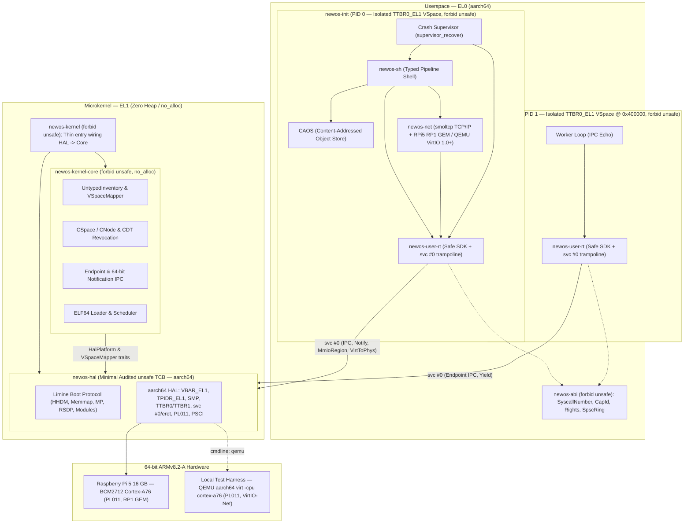

# NewOS

A pure **seL4-style 64-bit capability microkernel** and **post-UNIX EL0 environment** written in modern Rust — built solely for the **Raspberry Pi 5 16 GB** (`aarch64` / ARMv8.2-A quad-core BCM2712 Cortex-A76, with QEMU `aarch64` `virt` retained as a local test harness). Built with **zero kernel heap (`no_alloc` in EL1)**, **100% memory-safe Rust APIs (`#![forbid(unsafe_code)]` across core, networking & userspace)**, **SMP multi-core bring-up**, **isolated `TTBR0_EL1` address spaces**, **EL0 crash isolation**, an **EL0 `smoltcp` TCP/IP stack + RP1 Cadence GEM Gigabit Ethernet driver** (plus VirtIO 1.0+ for QEMU testing), a **Content-Addressed Object Store (CAOS)**, and a **Typed Pipeline Shell (`newos-sh`)**.

## Architecture Principles

- **Strict Liedtke Minimality (Ultra-Minimal EL1):**
  - Only CPU/exception dispatch, 4-level `VSpace` page tables, `CSpace` capability & `Untyped` memory enforcement, thread scheduling, and minimal IPC (`Endpoint`, 64-bit `Notification`, capability-scoped `MmioRegion`) live in the kernel.
  - Zero kernel heap (`no_alloc`): all 16 GB of physical memory is tracked in `UntypedInventory` (64 regions) and explicitly retyped into frames/page tables.
  - Networking (`smoltcp` IPv4/DHCPv4/DNS/ICMP/TCP + Raspberry Pi 5 RP1 Cadence GEM Gigabit Ethernet & QEMU VirtIO 1.0+), storage (CAOS), shell (`newos-sh`), shared-memory ring buffers, and crash supervision live in isolated EL0 processes.
- **100% Memory-Safe Rust Interfaces:**
  - `#![forbid(unsafe_code)]` is compiler-enforced on `newos-abi`, `newos-kernel-core`, `newos-kernel`, `newos-net`, `newos-init`, and `newos-worker`.
  - Audited `unsafe` is strictly confined to hardware/paging/context-switch instructions in `crates/hal` and the minimal `svc #0` trampoline in `crates/user-rt`.
- **Post-UNIX Userspace (Zero POSIX Paths / Zero Untyped Text Pipes):**
  - **Content-Addressed Object Store (CAOS):** Immutable blobs addressed by 64-bit `ObjHash` with automatic deduplication, lock-free reads, capability-gated named Refs (`@name`), instant atomic `rollback`, and irreversible `seal` (read-only attenuation).
  - **Typed Pipeline Shell (`newos-sh`):** Stages pass typed `Record` values (`Proc`, `Object`, `Ref`, `Metric`, `Count`) directly through `|` (`put "hello" | save @note`, `objects | where size > 20`, `procs | where pid == 1 | count`, `net dhcp`, `net ping`, `net resolve`).
- **Raspberry Pi 5 (16 GB) Hardware Target:**
  - Pure 64-bit `aarch64` compiled for `-C target-cpu=cortex-a76` (ARMv8.2-A, zero 32-bit, zero x86_64).
  - UEFI + Limine, 4-level `TTBR0_EL1`/`TTBR1_EL1` with ASID tagging, 4 KiB & 2 MiB block pages, `PXN`/`UXN` W^X + `MAIR_EL1` Device-nGnRnE, `svc #0`/`eret`, PSCI, BCM2712 3-pin JST Debug PL011 UART (`0x10_7D00_1000`), and RP1 Cadence GEM Gigabit Ethernet (`0x1F_0010_0000`) with 64-bit DMA.

## System Architecture



## Boot Sequence


## Workspace Layout

```text
newos/
├── rust-toolchain.toml          # Nightly toolchain + rust-src, llvm-tools-preview, aarch64-unknown-none
├── Cargo.toml                   # Workspace manifest
├── xtask/                       # Build automation: RPi5 FAT32 image & QEMU aarch64 virt test harness
├── crates/
│   ├── abi/                     # #![no_std], #![forbid(unsafe_code)] — Syscalls, CapId, Rights, SpscRing
│   ├── hal/                     # #![no_std], no_alloc — Minimal audited unsafe TCB (aarch64 / BCM2712)
│   ├── kernel-core/             # #![no_std], no_alloc, #![forbid(unsafe_code)] — Untyped, CSpace/CDT, ELF64, IPC, Sched
│   ├── kernel/                  # #![no_std], #![no_main], #![forbid(unsafe_code)] — Thin EL1 kernel binary
│   ├── user-rt/                 # #![no_std] — Safe EL0 Rust SDK (aarch64 svc #0)
│   ├── net/                     # #![no_std], no_alloc, #![forbid(unsafe_code)] — EL0 smoltcp + RP1 GEM & VirtIO 1.0+
│   ├── init/                    # #![no_std], #![no_main], #![forbid(unsafe_code)] — Root task, CAOS & `newos-sh`
│   └── worker/                  # #![no_std], #![no_main], #![forbid(unsafe_code)] — Isolated EL0 worker process
└── infra/
    └── startup.sh               # GCP Debian 13 + QEMU aarch64 + Rust nightly dev VM provisioning script
```

## Raspberry Pi 5 (16 GB) Deployment

Build the 64 MiB FAT32 UEFI boot image (`target/newos-rpi5.img`, configured for the BCM2712 Cortex-A76, 3-pin JST Debug PL011 UART at `0x10_7D00_1000`, and RP1 Cadence GEM Gigabit Ethernet at `0x1F_0010_0000`):

```bash
cargo xtask rpi5-image --release
```

To boot on a Raspberry Pi 5 (16 GB):
1. Flash `target/newos-rpi5.img` to a microSD card (or copy the contents of `target/rpi5_boot/` onto a FAT32-formatted microSD card).
2. Download `RPI_EFI.fd` from [worproject/rpi5-uefi](https://github.com/worproject/rpi5-uefi/releases) and place it on the FAT32 root alongside `config.txt`.
3. Connect a 3.3V UART adapter (e.g., Raspberry Pi Debug Probe) to the Pi 5 **3-pin JST Debug UART** at **115200 8N1** and power on to reach the interactive `newos λ ` shell.

## Build, Test & Local QEMU Harness

### Host Unit Tests & Clippy
```bash
cargo xtask host-test
cargo clippy --package newos-abi --package newos-kernel-core --package newos-shell-core --package newos-net --package xtask -- -D warnings
```

### Automated AArch64 UEFI + Limine + QEMU `virt` Test Suite
Requires `qemu-system-aarch64`, `qemu-efi-aarch64` (or `AAVMF` / Homebrew QEMU EDK2), `xorriso`, `dosfstools`, `mtools`, and Rust nightly:

```bash
cargo xtask test
```

### Interactive EL0 Shell (`newos-sh`) in QEMU `virt`
```bash
cargo xtask run
```

Example interactive commands at the `newos λ ` prompt:
```text
sys
get @guide
put "hello newos" | save @note
get @note
objects | where size > 20
refs | where writable == false
procs | where pid == 1 | count
ref rollback @note
ref seal @note
net
net dhcp
net ping 10.0.2.2
net resolve example.com
ping 0x1234
bench
crash
exit
```
