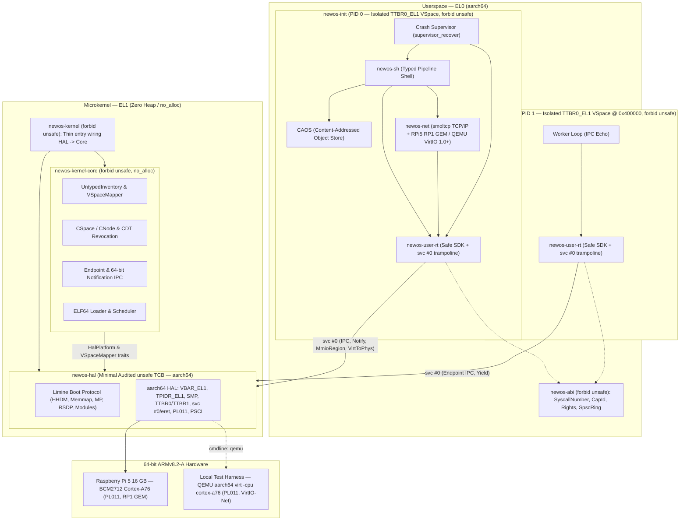
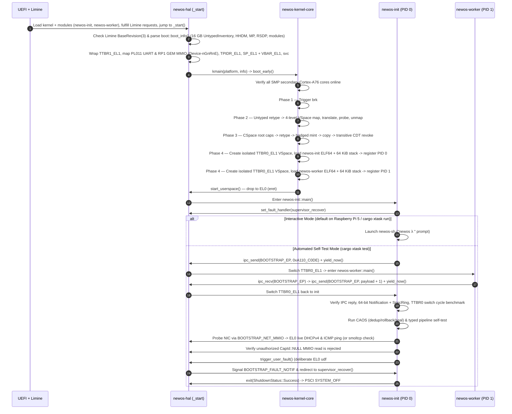

# NewOS

> **Release:** [`v0.3.0`](https://github.com/laurentgrangeau/newos/releases/tag/v0.3.0) · Pure Post-Quantum 3-Process SSH Server (`mlkem1024-sha3-512` + `ssh-mldsa87` + `chacha20-poly1305@openssh.com`) & OS-wide FIPS 202 `SHA3-512`.

A pure **seL4-style 64-bit capability microkernel** and **post-UNIX EL0 environment** written in modern Rust — built solely for the **Raspberry Pi 5 16 GB** (`aarch64` / ARMv8.2-A quad-core BCM2712 Cortex-A76, with QEMU `aarch64` `virt` retained as a local test harness). Built with **zero kernel heap (`no_alloc` in EL1)**, **100% memory-safe Rust APIs (`#![forbid(unsafe_code)]` across core, networking, RNG, PQ-SSH, shell, userspace & benchmarks)**, **Kernel PIE + Limine KASLR**, **Userspace PIE + full ASLR + KCFI + LLVM ShadowCallStack (`x18`)**, **SMP multi-core bring-up with GICv2 SGI wakeups**, **isolated `TTBR0_EL1` address spaces (16-bit ASIDs + full NEON/FP save/restore)**, **EL0 crash isolation**, **live ACPI hardware discovery (`FADT`/`SPCR`/`MADT`/`GTDT`/`MCFG`)**, a **3-process privilege-separated Pure Post-Quantum SSHv2 server (`newos-netd` + `newos-keyd` + `newos-sshd`)** with **hardware TRNG (`BCM2712 iproc-rng200` / `VirtIO-RNG`)**, an **EL0 `smoltcp` IPv4/IPv6 TCP/IP stack + RP1 Cadence GEM Gigabit Ethernet driver** (plus VirtIO 1.0+ for QEMU testing), a **FIPS 202 `SHA3-512` Content-Addressed Object Store (CAOS)**, and a **UTF-8 Typed Pipeline Shell (`newos-sh`)**.

## Architecture Principles

- **Strict Liedtke Minimality & Designated-Authority Object Capabilities (EL1):**
  - Only CPU/exception dispatch, 4-level `VSpace` page tables, `CSpace` capability & `Untyped` memory enforcement, preemptive thread scheduling, and minimal IPC (`Endpoint`, 64-bit `Notification`, capability-scoped `MmioRegion`) live in the kernel.
  - **Zero Ambient Authority:** All privileged syscalls require explicit, unforgeable `CapId` handles validated in the caller's isolated per-process `CNode<64>` — including `Console` (`DebugRead`/`DebugWrite`), `PowerControl` (`Exit`/`SysInfo`), `VSpace` (`MapPage`/`UnmapPage`/`VirtToPhys`/`FrameMap`), `Untyped` (`UntypedRetype`), `CNode` (`CapGrant`), and `Thread` (`SetPriority` with MCP ceiling). Non-root `worker` processes receive least-privilege bootstrap caps (`BOOTSTRAP_NOTIF`, `BOOTSTRAP_EP`, write-only `BOOTSTRAP_CONSOLE`, `BOOTSTRAP_SELF_THREAD`) and cannot shut down the machine, steal UART input, map memory, or escalate priority.
  - **Cross-Process CDT Revocation & Revocation-Driven Unmap:** `CapGrant` preserves cross-`CNode` `ExternalParent` links so `CapRevoke` transitively revokes capabilities across multi-hop process chains and automatically unmaps/reclaims any revoked `Frame` PTEs via `FrameMappingTracker`.
  - **Single-Use Reply Capabilities & Full 64-Bit IPC Badges:** `IpcCall` mints an implicit single-use Reply capability consumed on `IpcReplyRecv` (preventing reply hijacking); `svc #0` returns `(x0 = err, x1 = payload, x2 = badge)` with zero badge truncation. Compacted `CapSlot` (48 B), `CNode<64>` (3,096 B), and `KernelIpcState` (25,224 B) pair with O(1) leaf CDT revocation, O(1) per-endpoint waiter bitmasks, and coalesced 1024 B `DebugWrite` / REPL I/O to minimize IPC overhead.
  - Zero kernel heap (`no_alloc`): all 16 GB of physical memory is tracked in `UntypedInventory` (64 regions, auto-binding `BOOTSTRAP_UNTYPED` to the largest usable UEFI region) with region-designated `retype_frame_in`, zero-on-free LIFO frame reclamation, and 2 MiB superpages.
  - Networking (`smoltcp` IPv4/IPv6/DHCPv4/DNS A+AAAA/ICMP/TCP + Raspberry Pi 5 RP1 Cadence GEM Gigabit Ethernet & QEMU single-slot VirtIO 1.0+), storage (CAOS), shell (`newos-sh`), bounds-hardened shared-memory `SpscRing` buffers, and crash supervision live in isolated EL0 processes.
- **100% Memory-Safe Rust Interfaces & Formal Verification:**
  - `#![forbid(unsafe_code)]` is compiler-enforced on `newos-abi`, `newos-kernel-core`, `newos-kernel`, `newos-net`, `newos-rng`, `newos-key-vault`, `newos-ssh-proto`, `newos-netd`, `newos-keyd`, `newos-sshd`, `newos-ssh`, `newos-shell-core`, `newos-init`, `newos-worker`, `newos-bench`, and `tests/teamwork_e2e`.
  - Audited `unsafe` is strictly confined to hardware/paging/context-switch instructions in `crates/hal` (guarded by IRQ-disabling `IrqSpinLock`s, bounded descriptor helpers, and page-table-validated HHDM user copies) and the minimal `svc #0` / fault-recovery trampoline in `crates/user-rt` (with `set_fault_handler` implemented in safe Rust via `[AtomicU64; 8192]`), with documented `// SAFETY:` invariants on every site.
  - **Miri & Kani Verification:** `cargo xtask miri` verifies all 110 core tests with zero UB/aliasing/provenance violations; `#[cfg(kani)]` bounded model checking harnesses (`cargo xtask verify`) prove `SpscRing` FIFO & corrupted-peer safety, `CNode` monotonic rights attenuation & generational `CapId` safety, `PageFlags` W^X exclusivity, and `UntypedInventory` disjointness.
- **Defense-in-Depth AArch64 Security Hardening:**
  - **KASLR, PIE & Full EL0 ASLR:** Kernel compiled as PIE (`-C relocation-model=pie`) with Limine KASLR; EL0 binaries compiled as PIE (`ET_DYN`) with streaming `R_AARCH64_RELATIVE` relocation, randomized code/stack/shadow-stack bases (seeded with early BCM2712 hardware TRNG on Pi 5), unmapped 4 KiB stack guard pages, and **FIPS 202 `SHA3-512`** boot attestation digests (zero SHA-2 anywhere in the OS).
  - **Pure Post-Quantum 3-Process SSHv2 Server (`newos-netd` + `newos-keyd` + `newos-sshd`):**
    - **Zero Legacy Cryptography (NIST Level 5 / CNSA 2.0):** Enforces **only** `mlkem1024-sha3-512` (FIPS 203 ML-KEM-1024 + SHA3-512), hedged `ssh-mldsa87` (FIPS 204 ML-DSA-87 with distinct domain contexts `newos-ssh-kex-v1` / `newos-ssh-userauth-v1`), `chacha20-poly1305@openssh.com` (constant-time ARX AEAD), `SHA3-512`/`SHAKE256`, and `kex-strict` (Terrapin CVE-2023-48795 mitigation). Rejects classical KEX, RSA/ECDSA/Ed25519, passwords, `exec`, SFTP, and forwarding.
    - **Hardware Entropy & Fast-Key-Erasure CSPRNG (`newos-rng`):** Capability-scoped `BOOTSTRAP_RNG_MMIO` supporting **Raspberry Pi 5 BCM2712 `iproc-rng200`** (`0x10_7D20_8000`, zero DMA) and **QEMU `virtio-rng-device`**, with fail-closed NIST SP 800-90B startup health checks (RCT + APT) → `SHAKE256` conditioning → fast-key-erasure ChaCha20 CSPRNG.
    - **Strict seL4 Privilege Separation:** `newos-netd` (PID 2) exclusively owns `BOOTSTRAP_NET_MMIO` + read-only `VSpace`; `newos-keyd` (PID 3) exclusively owns `BOOTSTRAP_RNG_MMIO`, the ephemeral ML-DSA-87 host private key, single-use `session_id` replay protection, and write-only `BOOTSTRAP_AUTH_GATE_EP` (`keyd` → `init`); `newos-sshd` (PID 4) holds **zero MMIO**, **zero `VSpace`**, and **zero `AUTH_GATE_EP`**, bridged to `newos-sh` over unidirectional `BOOTSTRAP_SSH_SHELL_EP` / `BOOTSTRAP_SSH_OUT_EP` pipes.
  - **Control-Flow Integrity & ShadowCallStack:** `-Z sanitizer=kcfi` across EL1/EL0, plus real LLVM `-Z sanitizer=shadow-call-stack` (`x18` via `targets/aarch64-newos-user.json`) with per-process ASLR 8 KiB shadow stacks.
  - **Microarchitectural & Hardware Mitigations:** Probed ARMv8.2-A Cortex-A76 mitigations (`PAN`, `SSBS` / `SCTLR_EL1.DSSBS`, `CSV2`, `CSV3`); Cortex-A76 24-iteration Spectre-BHB clearing on EL0→EL1 entry; `csdb` Spectre v1 barriers; GPR/NEON scrubbing on fault redirect; zero-on-free frame reclaim; DMA cache maintenance (`dc cvac`/`dc civac`); capability-typed `IoSpace` placeholder reserved for BCM2712's `brcm,bcm2712-iommu` (BCM2712 does not include ARM SMMUv3).
- **Post-UNIX Userspace (Zero POSIX Paths / Zero Untyped Text Pipes):**
  - **Content-Addressed Object Store (CAOS):** Immutable blobs addressed by `const fn` **FIPS 202 `SHA3-512`** `ObjHash` with automatic deduplication, collision rejection, lock-free reads, mark-and-sweep `gc()`, validated binary snapshots (`encode_snapshot`/`decode_snapshot`), capability-gated named Refs (`@name`), instant atomic `rollback`, and irreversible `seal` (read-only attenuation).
  - **Typed Pipeline Shell (`newos-sh`):** Full UTF-8 multi-byte input & scalar-aware backspace; stages pass typed `Record` values (`Proc`, `Object`, `Ref`, `Metric`, `Count`) directly through `|` (`put "hello" | save @note`, `objects | where size > 20`, `procs | where el == 0 | count`, `net dhcp`, `net ping`, `net resolve`).
- **Raspberry Pi 5 (16 GB) Hardware Target:**
  - Pure 64-bit `aarch64` compiled for `-C target-cpu=cortex-a76` (ARMv8.2-A, zero 32-bit, zero x86_64, zero legacy ISO9660/El Torito).
  - Pure **UEFI GPT + FAT32 ESP** disk images (`xtask/src/gpt.rs`), Limine, live **ACPI** hardware discovery (`FADT` PSCI `SMC`/`HVC` conduit, `SPCR` PL011 UART, `MADT` GICv2/GIC-400 + CPUs, `GTDT` Generic Timer GSIV, `MCFG` PCIe ECAM), GICv2 distributor/CPU interface + cross-core SGI wakeups, 4-level `TTBR0_EL1`/`TTBR1_EL1` with 16-bit ASIDs, full 528-byte NEON/FP context save/restore, dynamic `CNTFRQ_EL0` (`TimerFreq`), clean `ThreadExit`, `IrqHandler`/`IrqAck`, 4 KiB & 2 MiB block pages, `PXN`/`UXN` W^X, ARMv8.1-A **PAN**, `MAIR_EL1` Device-nGnRnE, BCM2712 3-pin JST Debug PL011 UART (`0x10_7D00_1000`), and RP1 Cadence GEM Gigabit Ethernet (`0x1F_0010_0000`) with 64-bit DMA.

## System Architecture



## Boot Sequence



## Workspace Layout

```text
newos/
├── rust-toolchain.toml          # Nightly toolchain + rust-src, llvm-tools-preview, aarch64-unknown-none
├── Cargo.toml                   # Workspace manifest (v0.3.0 released)
├── BENCHMARK_RESULTS.md         # Reproducible 28-metric before/after kernel, shell & IPC benchmarks
├── targets/
│   └── aarch64-newos-user.json  # Custom EL0 PIE target spec enabling KCFI + LLVM ShadowCallStack (x18)
├── xtask/                       # Build automation: pure UEFI GPT+FAT32 ESP images, QEMU, Miri, Kani & benchmarks
├── crates/
│   ├── abi/                     # #![no_std], #![forbid(unsafe_code)] — Syscalls, CapId, Rights, SpscRing, FIPS 202 SHA3-512/SHAKE256, IPC wire protocols
│   ├── hal/                     # #![no_std], no_alloc — Minimal audited unsafe TCB (aarch64, GICv2, SMP, ACPI, RNG200/VirtIO-RNG MMIO)
│   ├── kernel-core/             # #![no_std], no_alloc, #![forbid(unsafe_code)] — Untyped, CSpace/CDT, ELF64 PIE, ACPI, IPC, Sched + Kani proofs
│   ├── kernel/                  # #![no_std], #![no_main], #![forbid(unsafe_code)] — Thin EL1 kernel binary
│   ├── user-rt/                 # #![no_std] — Safe EL0 Rust SDK (aarch64 svc #0)
│   ├── net/                     # #![no_std], no_alloc, #![forbid(unsafe_code)] — Persistent EL0 smoltcp NetStack + RP1 GEM & VirtIO 1.0+
│   ├── rng/                     # #![no_std], no_alloc, #![forbid(unsafe_code)] — BCM2712 RNG200 / VirtIO-RNG + SP 800-90B health + fast-key-erasure CSPRNG
│   ├── key-vault/               # #![no_std], no_alloc, #![forbid(unsafe_code)] — Ephemeral ML-DSA-87 signing vault, replay-proof auth-gate & key_ipc server
│   ├── ssh/                     # #![no_std], no_alloc, #![forbid(unsafe_code)] — Pure-PQ SSHv2 engine (ML-KEM-1024 + ML-DSA-87 + ChaCha20-Poly1305 + kex-strict)
│   ├── netd/                    # #![no_std], #![no_main], #![forbid(unsafe_code)] — Isolated EL0 Network & DMA daemon (PID 2)
│   ├── keyd/                    # #![no_std], #![no_main], #![forbid(unsafe_code)] — Isolated EL0 Entropy & ML-DSA-87 Vault daemon (PID 3)
│   ├── sshd/                    # #![no_std], #![no_main], #![forbid(unsafe_code)] — Isolated EL0 Zero-MMIO SSHv2 daemon (PID 4)
│   ├── ssh-client/              # #![forbid(unsafe_code)] — Pure-PQ Rust Linux/macOS CLI client (`newos-ssh` + `newos-ssh keygen`)
│   ├── shell-core/              # #![no_std], no_alloc, #![forbid(unsafe_code)] — CAOS (SHA3-512) & Typed Pipeline Shell (`newos-sh`)
│   ├── bench/                   # #![forbid(unsafe_code)] — 28-metric kernel, shell & IPC benchmark suite
│   ├── init/                    # #![no_std], #![no_main], #![forbid(unsafe_code)] — Root task, CAOS, `newos-sh` & auth-gated SSH shell bridge (PID 0)
│   └── worker/                  # #![no_std], #![no_main], #![forbid(unsafe_code)] — Isolated EL0 worker process (PID 1)
├── tests/
│   └── teamwork_e2e/            # #![forbid(unsafe_code)] — 5-tier opaque-box E2E & adversarial verification suite (114 tests)
└── infra/
    └── startup.sh               # GCP Debian 13 + QEMU aarch64 + Rust nightly dev VM provisioning script
```

## Benchmarks & Performance

`cargo xtask bench` runs a reproducible **28-metric** release (`-C opt-level=3`, median of 5 samples) suite covering kernel speed, shell speed, IPC syscall/payload consumption, and IPC/shell memory footprints. Full before/after results are tracked in [`BENCHMARK_RESULTS.md`](BENCHMARK_RESULTS.md).

Selected highlights from the `v0.1.0` optimization pass:
- **Kernel & IPC Speed:** `cnode.lookup` `-17.4%` (`0.95` ns/op), `cnode.mint_revoke` `-16.5%` (`12.96` ns/op), `ipc.send_recv` `-12.6%` (`2.15` ns/op), `sched.schedule_next` `-8.0%` (`6.44` ns/op); **~159 cycles per `TTBR0_EL1` address-space switch** in release on AArch64 QEMU (`cortex-a76`).
- **Shell & CAOS Speed:** `shell.session.full` `-29.5%`, `shell.caos.put_get_ref` `-22.5%`, `shell.pipeline.eval` `-17.4%`.
- **IPC Syscall & Payload Reduction:** `shell_session.debug_write_bytes` `-28.8%` (`1,857 -> 1,322` B), `repl_line.payload_bytes` `-26.9%` (`813 -> 594` B), `repl_line.syscalls` `-14.3%` (`21 -> 18`), `debug_write_syscalls` `-12.5%` (`16 -> 14`), `idle_poll_100.wasted_worker_ipc` = `0`.
- **Memory Footprints:** `CapSlot` `-33.3%` (`48` B), `CNode<64>` `-33.0%` (`3,096` B), `KernelIpcState` `-32.8%` (`25,224` B), `RecordStream` `-43.6%` (`1,160` B), `Shell` `-17.8%` (`6,296` B).

```bash
cargo xtask bench             # Human-readable table
cargo xtask bench --markdown  # Markdown table
cargo xtask bench --json      # Machine-readable JSON
```

## Raspberry Pi 5 (16 GB) Deployment

Build the 64 MiB FAT32 UEFI boot image (`target/newos-rpi5.img`, configured for the BCM2712 Cortex-A76, 3-pin JST Debug PL011 UART at `0x10_7D00_1000`, and RP1 Cadence GEM Gigabit Ethernet at `0x1F_0010_0000`):

```bash
cargo xtask rpi5-image --release
```

To boot on a Raspberry Pi 5 (16 GB):
1. Flash `target/newos-rpi5.img` to a microSD card (or copy the contents of `target/rpi5_boot/` onto a FAT32-formatted microSD card).
2. Download `RPI_EFI.fd` from [worproject/rpi5-uefi](https://github.com/worproject/rpi5-uefi/releases) and place it on the FAT32 root alongside `config.txt`.
3. Connect a 3.3V UART adapter (e.g., Raspberry Pi Debug Probe) to the Pi 5 **3-pin JST Debug UART** at **115200 8N1** and power on to reach the interactive `newos λ ` shell.

## Build, Test & Local QEMU Harness

### Host Unit Tests, Miri, Kani, Clippy & Formatting
```bash
cargo xtask host-test
cargo xtask miri            # Miri UB / aliasing / provenance checks (110 tests)
cargo xtask verify          # Kani bounded model checking proofs (optional)
cargo fmt --check
cargo clippy --all-targets -- -D warnings
```

### Automated AArch64 UEFI GPT + Limine + QEMU `virt` Test Suite
Requires `qemu-system-aarch64`, `qemu-efi-aarch64` (or `AAVMF` / Homebrew QEMU EDK2), `dosfstools`, `mtools`, and Rust nightly (zero `xorriso` / ISO9660 dependency):

```bash
cargo xtask test            # Debug build + QEMU aarch64 boot & 6-phase self-test
cargo xtask test --release  # Release-optimized build + QEMU aarch64 verification
```

### Interactive EL0 Shell (`newos-sh`) & Pure Post-Quantum SSH in QEMU `virt`
```bash
# 1. Generate a pure ML-DSA-87 user keypair and embed the public key in `newos-keyd`
cargo run --release -p newos-ssh -- keygen ~/.config/newos-ssh/id_mldsa87
cp ~/.config/newos-ssh/id_mldsa87.pub authorized_keys.mldsa87

# 2. Boot NewOS in QEMU (attaches VirtIO-RNG + forwards host TCP :2222 -> guest :22)
cargo xtask run --release

# 3. Connect from another terminal using the SHA3-512 host fingerprint printed by `[keyd]`
./target/release/newos-ssh \
  -i ~/.config/newos-ssh/id_mldsa87 \
  --fingerprint SHA3-512:<printed-by-keyd> \
  -p 2222 newos@127.0.0.1
```

Example interactive commands at the `newos λ ` prompt:
```text
sys
get @guide
put "hello newos" | save @note
get @note
objects | where size > 20
refs | where writable == false
procs | where el == 0 | count
procs | where pid == 1 | count
ref rollback @note
ref seal @note
net
net dhcp
net ping 10.0.2.2
net resolve example.com
ping 0x1234
bench
crash
exit
```
