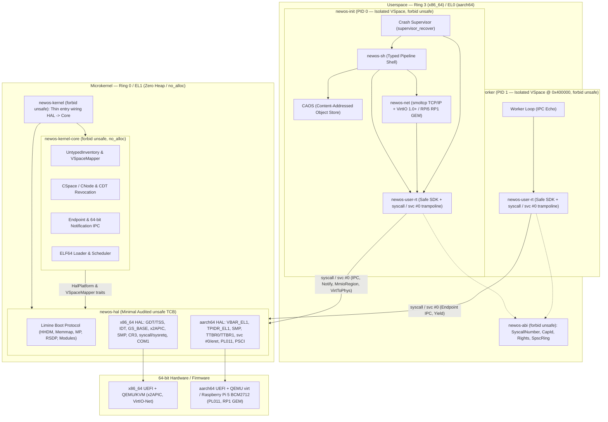
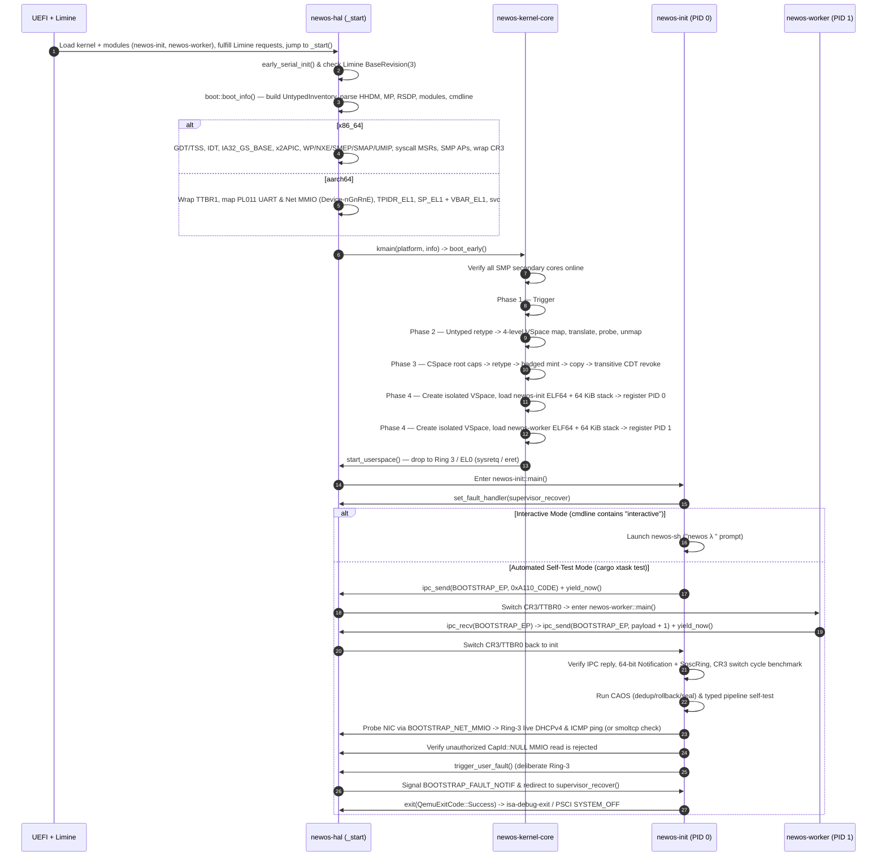

# NewOS

A pure **seL4-style 64-bit capability microkernel** and **post-UNIX Ring-3/EL0 environment** written in modern Rust — targeting both **`x86_64`** (UEFI + Limine + x2APIC) and **`aarch64`** (ARMv8.2-A Cortex-A76 / **Raspberry Pi 5 16 GB**). Built with **zero kernel heap (`no_alloc` in Ring 0/EL1)**, **100% memory-safe Rust APIs (`#![forbid(unsafe_code)]` across core, networking & userspace)**, **SMP multi-core bring-up**, **isolated `CR3`/`TTBR0_EL1` address spaces**, **Ring-3 crash isolation**, a **Ring-3 `smoltcp` TCP/IP stack + VirtIO 1.0+ network driver**, a **Content-Addressed Object Store (CAOS)**, and a **Typed Pipeline Shell (`newos-sh`)**.

## Architecture Principles

- **Strict Liedtke Minimality (Ultra-Minimal Ring 0 / EL1):**
  - Only CPU/interrupt dispatch, 4-level `VSpace` page tables, `CSpace` capability & `Untyped` memory enforcement, thread scheduling, and minimal IPC (`Endpoint`, 64-bit `Notification`, capability-scoped `MmioRegion`) live in the kernel.
  - Zero kernel heap (`no_alloc`): all physical memory is tracked in `UntypedInventory` and explicitly retyped into frames/page tables.
  - Networking (`smoltcp` IPv4/DHCPv4/DNS/ICMP + VirtIO 1.0+ & Raspberry Pi 5 RP1 Cadence GEM Gigabit Ethernet), storage (CAOS), shell (`newos-sh`), shared-memory ring buffers, and crash supervision live in isolated Ring-3 / EL0 processes.
- **100% Memory-Safe Rust Interfaces:**
  - `#![forbid(unsafe_code)]` is compiler-enforced on `newos-abi`, `newos-kernel-core`, `newos-kernel`, `newos-net`, `newos-init`, and `newos-worker`.
  - Audited `unsafe` is strictly confined to hardware/MSR/paging/context-switch instructions in `crates/hal` and the minimal `syscall`/`svc #0` trampoline in `crates/user-rt`.
- **Post-UNIX Userspace (Zero POSIX Paths / Zero Untyped Text Pipes):**
  - **Content-Addressed Object Store (CAOS):** Immutable blobs addressed by 64-bit `ObjHash` with automatic deduplication, lock-free reads, capability-gated named Refs (`@name`), instant atomic `rollback`, and irreversible `seal` (read-only attenuation).
  - **Typed Pipeline Shell (`newos-sh`):** Stages pass typed `Record` values (`Proc`, `Object`, `Ref`, `Metric`, `Count`) directly through `|` (`put "hello" | save @note`, `objects | where size > 20`, `procs | where pid == 1 | count`, `net dhcp`, `net ping`, `net resolve`).
- **Modern 64-bit Hardware Only:**
  - Zero 32-bit, zero legacy BIOS/MBR, zero legacy xAPIC MMIO, zero legacy VirtIO v1.
  - `x86_64`: Pure 64-bit UEFI + Limine, x2APIC MSRs, `syscall`/`sysretq`, `WP`/`NXE`/`SMEP`/`SMAP`/`UMIP`, W^X page tables.
  - `aarch64`: ARMv8.2-A Cortex-A76 (QEMU `virt` & Raspberry Pi 5 BCM2712), UEFI + Limine, 4-level `TTBR0_EL1`/`TTBR1_EL1` with `PXN`/`UXN` + `MAIR_EL1` Device-nGnRnE, `svc #0`/`eret`, PSCI.

## System Architecture



## Boot Sequence



## Workspace Layout

```text
newos/
├── rust-toolchain.toml          # Nightly toolchain + rust-src, llvm-tools-preview, x86_64/aarch64-unknown-none
├── Cargo.toml                   # Workspace manifest
├── xtask/                       # Build automation: dual-arch UEFI ISO, QEMU/KVM tests & RPi5 FAT32 image
├── crates/
│   ├── abi/                     # #![no_std], #![forbid(unsafe_code)] — Syscalls, CapId, Rights, SpscRing
│   ├── hal/                     # #![no_std], no_alloc — Minimal audited unsafe TCB (x86_64 & aarch64)
│   ├── kernel-core/             # #![no_std], no_alloc, #![forbid(unsafe_code)] — Untyped, CSpace/CDT, ELF64, IPC, Sched
│   ├── kernel/                  # #![no_std], #![no_main], #![forbid(unsafe_code)] — Thin Ring-0/EL1 kernel binary
│   ├── user-rt/                 # #![no_std] — Safe Ring-3/EL0 Rust SDK (x86_64 syscall & aarch64 svc #0)
│   ├── net/                     # #![no_std], no_alloc, #![forbid(unsafe_code)] — Ring-3 smoltcp + VirtIO 1.0+ driver
│   ├── init/                    # #![no_std], #![no_main], #![forbid(unsafe_code)] — Root task, CAOS & `newos-sh`
│   └── worker/                  # #![no_std], #![no_main], #![forbid(unsafe_code)] — Isolated Ring-3/EL0 worker process
└── infra/
    └── startup.sh               # GCP Debian 13 + QEMU/KVM + Rust nightly dev VM provisioning script
```

## Build, Test & Run

### Host Unit Tests & Clippy
```bash
cargo xtask host-test
cargo clippy --package newos-abi --package newos-kernel-core --package newos-net --package xtask -- -D warnings
```

### Automated Dual-Arch UEFI + Limine + QEMU Test Suite
Requires `qemu-system-x86_64`, `qemu-system-aarch64`, `ovmf`, `qemu-efi-aarch64`, `xorriso`, `dosfstools`, `mtools`, and Rust nightly (all pre-installed on `newos-dev`):

```bash
cargo xtask test --arch x86_64
cargo xtask test --arch aarch64
```

### Interactive Ring-3 / EL0 Shell (`newos-sh`)
```bash
cargo xtask run --arch x86_64
cargo xtask run --arch aarch64
```

Example interactive commands at the `newos λ ` prompt:
```text
get @guide
put "hello newos" | save @note
get @note
objects | where size > 20
refs | where writable == false
procs | where pid == 1 | count
ref rollback @note
ref seal @note
net
net dhcp
net ping 10.0.2.2
net resolve example.com
ping 0x1234
bench
crash
exit
```

## Raspberry Pi 5 (16 GB) Deployment

Build the 64 MiB FAT32 UEFI boot image (`target/newos-rpi5.img`, configured for the BCM2712 3-pin JST Debug PL011 UART at `0x10_7D00_1000`):

```bash
cargo xtask rpi5-image
```

To boot on a Raspberry Pi 5:
1. Flash `target/newos-rpi5.img` to a microSD card (or copy the contents of `target/rpi5_boot/` onto a FAT32-formatted microSD card).
2. Download `RPI_EFI.fd` from [worproject/rpi5-uefi](https://github.com/worproject/rpi5-uefi/releases) and place it on the FAT32 root alongside `config.txt`.
3. Connect a 3.3V UART adapter (e.g., Raspberry Pi Debug Probe) to the Pi 5 **3-pin JST Debug UART** at **115200 8N1** and power on to reach the interactive `newos λ ` shell.

## GCP Dev VM (`newos-dev`)

The private Debian 13 + QEMU/KVM dev VM in `lgu-demos` has no public IP and is accessed exclusively via IAP (with outbound HTTPS via Cloud NAT):

```bash
gcloud compute ssh newos-dev \
  --project=lgu-demos \
  --zone=europe-west1-b \
  --tunnel-through-iap
```
